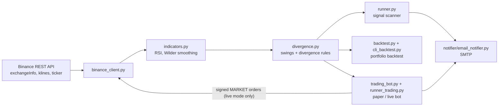

# CTON: Crypto Trading Opportunity Notifier

CTON scans every Binance USDC spot pair across several timeframes for RSI divergences and emails you a digest of the signals it finds. The same signal engine also drives a portfolio backtester and a trading bot that runs in paper mode by default.

> **Disclaimer:** This is a personal research and learning project, not financial advice. Crypto trading is risky. If you run it, you do so at your own risk. Keep the trading bot in paper mode, and use a Binance testnet or sandbox account for any order-path experiments. Never put keys for a funded account in `.env`.

## Features

- **Market scanner.** Finds all active (`TRADING`) Binance spot symbols quoted in USDC. It pulls OHLCV candles for any set of intervals (default `1M, 1w, 1d, 4h`) and emails bullish and bearish RSI divergences over SMTP.
- **Indicators written from scratch.** RSI uses Wilder smoothing, and swing highs and lows come from a fractal window. There is no pandas or NumPy. The runtime needs only `requests` and `python-dotenv`.
- **Portfolio backtester (CLI).** Replays divergence trades across many symbols in time order. It allocates a fraction of free capital to each trade, caps concurrent positions, and exits on stop, target, or timeout.
- **Trading bot.** It polls on a fixed interval, opens positions on new divergences, tracks stop and target levels, and emails OPEN/CLOSE notices with a positions, PnL, and equity summary. It runs in paper mode unless Binance API keys are set. Live mode places HMAC-SHA256 signed market orders.
- **Configured through `.env`.** SMTP settings, strategy tunables, and risk parameters are all environment variables (see [Configuration](#configuration)).

## How it works



### Signal: RSI divergence

1. Compute RSI (default period 14) on candle closes.
2. Find swing points on the close series with a fractal window `k` (default `SWING_K=2`). Index `i` is a swing high if its close is above the `k` closes before it and at least as high as the `k` closes after it. Swing lows are the mirror image.
3. Compare the last two swings of the same kind:
   - **Bullish:** price makes a lower low while RSI makes a higher low.
   - **Bearish:** price makes a higher high while RSI makes a lower high.
4. The scanner and the bot take the most recent divergence in the fetched window. The backtester uses every divergence in its history.

### Trade rules (backtester and bot)

- **Entry:** 0.1% better than the close of the divergence swing candle. That means ×0.999 for longs and ×1.001 for shorts.
- **Stop / target:** `STOP_PCT` (default 5%) and `TARGET_PCT` (default 10%) from the entry price.
- **Sizing:** each trade gets `ALLOCATION_FRACTION` (default 25%) of the current free capital, with at most `MAX_OPEN_TRADES` (default 4) positions open at once.
- **Backtester only:** if a candle touches both stop and target, the target wins. Trades that hit neither are closed at the close of candle `max-hold-candles` (default 30).

More detail is in [ARCHITECTURE.md](ARCHITECTURE.md).

## Tech stack

- Python 3.11+ standard library: `dataclasses`, `argparse`, `smtplib`, `hmac`/`hashlib`
- [`requests`](https://pypi.org/project/requests/) for the Binance REST API (v3 spot endpoints)
- [`python-dotenv`](https://pypi.org/project/python-dotenv/) for configuration
- `pytest` for tests

## Repository layout

```
cton/
├── cton/
│   ├── config.py             # Loads the Config dataclass from .env / environment
│   ├── binance_client.py     # REST client: symbols, klines (with pagination), price, signed orders
│   ├── indicators.py         # RSI (Wilder)
│   ├── divergence.py         # Swing detection, latest/all divergence finders
│   ├── strategies/
│   │   └── rsi_divergence.py # Runs divergence detection over symbols x timeframes
│   ├── notifier/
│   │   └── email_notifier.py # Email formatting + SMTP send
│   ├── runner.py             # CLI: signal scanner (one-off or loop)
│   ├── backtest.py           # Per-symbol and portfolio backtest engines
│   ├── cli_backtest.py       # CLI: portfolio backtest
│   ├── trading_bot.py        # Paper/live trading bot with email notifications
│   └── runner_trading.py     # CLI: trading bot loop
├── tests/                    # pytest unit tests (RSI, divergence)
├── .env.example              # Template for every environment variable the code reads
├── ARCHITECTURE.md
└── requirements.txt
```

## Getting started

```bash
git clone https://github.com/karimimh/cton.git
cd cton
python3 -m venv .venv
source .venv/bin/activate
pip install -r requirements.txt
cp .env.example .env   # then edit .env
```

Run every command from the repository root. The project is not packaged as an installable distribution.

## Usage

### 1. Signal scanner

```bash
python -m cton.runner --once                       # one scan, then exit (also the default with no flags)
python -m cton.runner --loop --sleep-seconds 900   # scan every 15 minutes
```

| Flag | Default | Description |
|------|---------|-------------|
| `--once` | | Run a single scan and exit |
| `--loop` | | Run continuously |
| `--sleep-seconds` | `900` | Seconds between scans in loop mode |

The scanner needs the SMTP variables in `.env`. When it finds signals, it sends one email with this format (the values here are illustrative):

```
Subject: CTON 2025-09-27 12:00Z (2 signals)

RSI Divergence Signals

Bullish:
  BTCUSDC 1d bullish divergence price 61250.0->60110.0 rsi 31.2->36.8

Bearish:
  ETHUSDC 4h bearish divergence price 2610.5->2655.0 rsi 68.4->61.9
```

### 2. Portfolio backtester

The backtester uses only public market-data endpoints. It needs no `.env` and no API keys.

```bash
python -m cton.cli_backtest --timeframe 4h --days 365 --limit-symbols 50
```

| Flag | Default | Description |
|------|---------|-------------|
| `--timeframe` | `4h` | Binance kline interval |
| `--days` | `365` | Days of history back from now |
| `--limit-symbols` | `50` | Max number of USDC-quoted symbols to test |
| `--rsi-period` | `14` | RSI period |
| `--swing-k` | `2` | Fractal window for swing detection |
| `--stop-pct` | `5.0` | Stop-loss distance (%) |
| `--target-pct` | `10.0` | Take-profit distance (%) |
| `--initial-capital` | `1000.0` | Starting capital |
| `--alloc-frac` | `0.25` | Fraction of current capital per new trade |
| `--max-open` | `4` | Max concurrent positions |
| `--max-hold-candles` | `30` | Timeout exit after N candles |

The output is a chronological trade table with entry and exit times (epoch ms), prices, result (`target` / `stop` / `timeout`), holding period, allocation, and PnL. It ends with the final capital and total return.

### 3. Trading bot

```bash
python -m cton.runner_trading --sleep-seconds 900
```

With `BINANCE_API_KEY` and `BINANCE_API_SECRET` left blank, the bot runs in **paper mode**: orders are simulated and capital is tracked in memory. Each cycle, it scans `TRADE_TIMEFRAME` candles for new divergences, opens positions, then checks open positions against their stop and target. Every OPEN/CLOSE triggers an email. The bot skips an OPEN email whose position state matches the previous one.

## Configuration

Copy `.env.example` to `.env`. `cton.runner` and `cton.runner_trading` both need the SMTP and email variables. `cton.cli_backtest` reads no environment variables.

| Variable | Default | Used by | Description |
|----------|---------|---------|-------------|
| `SMTP_HOST` | required | scanner, bot | SMTP server hostname |
| `SMTP_PORT` | `587` | scanner, bot | SMTP server port |
| `SMTP_USER` | required | scanner, bot | SMTP username |
| `SMTP_PASS` | required | scanner, bot | SMTP password (an app password is recommended) |
| `EMAIL_FROM` | required | scanner, bot | Sender address |
| `EMAIL_TO` | required | scanner, bot | Comma-separated recipients |
| `STARTTLS` | `true` | scanner, bot | Use STARTTLS |
| `RSI_PERIOD` | `14` | scanner, bot | RSI period |
| `SWING_K` | `2` | scanner, bot | Fractal window for swing detection |
| `MIN_RSI_LOOKBACK` | `120` | scanner, bot | Candles fetched = `min(MAX_CANDLES_FETCH, MIN_RSI_LOOKBACK + 50)` |
| `MAX_CANDLES_FETCH` | `500` | scanner, bot | Upper bound on candles per request |
| `SYMBOL_LIMIT` | all | scanner, bot | Optional cap on the number of symbols |
| `REQUEST_TIMEOUT` | `10` | scanner, bot | HTTP timeout (seconds) |
| `TIMEFRAMES` | `1M,1w,1d,4h` | scanner | Comma-separated Binance intervals to scan |
| `TRADE_TIMEFRAME` | `4h` | bot | Interval the bot trades on |
| `INITIAL_CAPITAL` | `1000` | bot | Starting capital for paper-mode tracking |
| `ALLOCATION_FRACTION` | `0.25` | bot | Fraction of free capital per trade |
| `MAX_OPEN_TRADES` | `4` | bot | Max concurrent positions |
| `STOP_PCT` | `5` | bot | Stop-loss distance (%) |
| `TARGET_PCT` | `10` | bot | Take-profit distance (%) |
| `MAX_HOLD_CANDLES` | `30` | (not yet enforced) | Loaded into config. The live bot does not use it yet. |
| `ALLOW_SHORTS` | `false` | bot | Act on bearish signals (keep `false` for spot) |
| `BINANCE_API_KEY` / `BINANCE_API_SECRET` | blank | bot | Blank = paper mode. Set = **real** orders (see below). |

## Testing

```bash
pip install pytest
python -m pytest -q
```

Use `python -m pytest` from the repo root, which puts the root on `sys.path`. A bare `pytest` cannot import the `cton` package because the project has no packaging config.

## Project status and known limitations

This is a working prototype: the scanner, the backtester, and the paper-mode bot all run end to end against the live Binance API. It is not production trading software. Known gaps:

- **No testnet routing.** `BinanceClient` always targets `https://api.binance.com`. Its `sandbox` argument exists but does nothing yet.
- **Live mode only sends entry orders.** Stop and target exits are detected by polling the ticker price, and they are logged and emailed, but no exit order is sent to the exchange. Positions and capital live in memory and are lost on restart.
- **Order quantities ignore exchange filters.** They are formatted to 6 decimals without checking Binance `LOT_SIZE` or `MIN_NOTIONAL` rules.
- **Short-side handling is incomplete.** The live exit checks are written for longs, and spot accounts cannot short. Keep `ALLOW_SHORTS=false`.
- **Signal timing.**
  - The scanner reports the most recent divergence in its lookback window on every run, with no deduplication across runs.
  - The last kline Binance returns is the candle that is still forming.
  - A swing is only confirmed once `k` later candles exist, but the backtester enters on the candle right after the swing. Backtest results therefore include look-ahead bias, and they also assume limit fills with no fees or slippage.
- **Networking.** Requests run one at a time, with no retry/backoff or rate-limit handling.

## Roadmap

- Testnet support, exchange-side exit orders, and LOT_SIZE/notional rounding
- Persisting open positions and already-sent signals across restarts
- Retry/backoff, rate-limit awareness, and parallel candle fetching
- More confirmation signals (MACD/OBV divergence, trend and volume filters)
- Telegram or Slack notifiers
- Dockerfile and CI (lint + tests)
